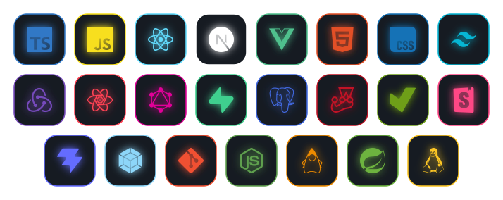

<h1 align="center">Ahmed El-Gendy</h1>

Software Engineer (More Specialist in Frontend Engineering) in Cairo. Firefox DevTools contributor. Open to relocation (EU).

  

## About

I build fast, accessible web interfaces with TypeScript, React, and Next.js, and I ship open source that real developers use. CS graduate (GPA 3.61, ranked 10th), roughly a year of professional experience.

## Contributions

### Mozilla Firefox DevTools (open source)

Contributing to the Inspector to improve CSS debugging, accessibility, and developer experience.

- **Grid lanes badge:** shipped `grid-lanes` and `inline-grid-lanes` badges in the markup view, live in Firefox 160.0a1 Nightly. [Bug 2076779](https://bugzilla.mozilla.org/show_bug.cgi?id=2076779)
- **Inactive CSS detection:** fixed warnings for `display: grid-lanes` so property hints stay accurate on a brand-new CSS feature. [Bug 2076777](https://bugzilla.mozilla.org/show_bug.cgi?id=2076777)
- **Keyboard accessibility:** fixed a 9-year-old bug where focus was lost after deleting an attribute, with a regression test. [Bug 1327787](https://bugzilla.mozilla.org/show_bug.cgi?id=1327787)
- **Eyedropper:** fixed scrolling while the eyedropper is open and made the screenshot update on scroll, so developers pick the right color. [Bug 1377755](https://bugzilla.mozilla.org/show_bug.cgi?id=1377755)

### GreatFrontEnd (bug reports)

Active user of [GreatFrontEnd](https://www.greatfrontend.com/). It's closed source, so I contribute by filing detailed bug reports.

- **React `key` prop answer:** reported a misconception in the official explanation. The creator rewrote it to cover stable identity, reconciliation, state, refs, and DOM association. [Post](https://www.linkedin.com/feed/update/urn:li:activity:7500416530107691008/)
- **`drop-while` question:** reported a bug in the question. [Issue #320](https://github.com/greatfrontend/greatfrontend/issues/320#issuecomment-5741682664)

## Tech

  

## Currently learning

Golang for Backend systems and browser engine work, Webpack Module Federation

## Find me

  
  
  

[Blog](https://stack-stories.netlify.app/) | [Portfolio](https://shofa.vercel.app)
